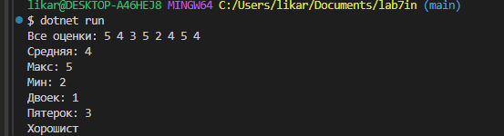
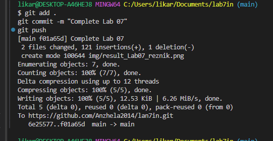

# практическая работа №7
**ФИО:** резник анжелика ильинична

**Группа:** ИСП-242

**Дата:** 29.10.2026

## что изучено в лабе
- Поняла как создавать массивы целых чисел int[] для хранения оценок
- Индексы у массивов всегда строго с нуля начинаются
- foreach нужен чтобы просто быстро прочитать элементы а обычный цикл for нужен когда мы хотим изменить элементы внутри массива

## Скриншоты
Вот скрин как работает программа журнал оценок:

А тут скриншот из терминала после отправки кода:
